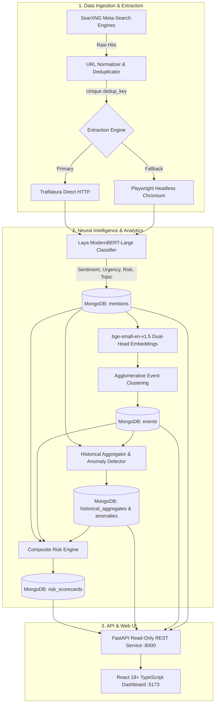

# Brand Reputation Early-Warning System (Brand Reputation Monitor)

[](https://www.python.org/)
[](https://fastapi.tiangolo.com/)
[](https://react.dev/)
[](https://www.typescriptlang.org/)
[](https://www.mongodb.com/)
[](https://docker.com/)

A comprehensive, production-grade brand intelligence and early-warning reputation monitoring platform. The system orchestrates multi-engine search discovery, full-text web extraction, ModernBERT-based neural classification, dense semantic embeddings, agglomerative event clustering, longitudinal anomaly detection, a multi-signal risk engine, a high-performance read-only FastAPI service, and a dark-themed React dashboard.

---

## Table of Contents

- [System Architecture](#system-architecture)
- [Key Features](#key-features)
- [Phase-by-Phase Technical Breakdown](#phase-by-phase-technical-breakdown)
  - [Phase 1: Multi-Engine Discovery](#phase-1-multi-engine-discovery)
  - [Phase 2: URL Normalization & Deduplication](#phase-2-url-normalization--deduplication)
  - [Phase 3: Dual-Stage Content Extraction](#phase-3-dual-stage-content-extraction)
  - [Phase 4: Multi-Task Classification (Laya)](#phase-4-multi-task-classification-laya)
  - [Phase 5: MongoDB Persistence](#phase-5-mongodb-persistence)
  - [Phase 6: Embeddings & Event Clustering](#phase-6-embeddings--event-clustering)
  - [Phase 7: Historical Aggregations & Anomaly Detection](#phase-7-historical-aggregations--anomaly-detection)
  - [Phase 8: Risk Engine & Scorecard](#phase-8-risk-engine--scorecard)
  - [Phase 9: FastAPI REST API](#phase-9-fastapi-rest-api)
  - [Phase 10: React Dashboard](#phase-10-react-dashboard)
- [Tech Stack](#tech-stack)
- [Directory Structure](#directory-structure)
- [Prerequisites & Environment Configuration](#prerequisites--environment-configuration)
- [Quick Start Guide](#quick-start-guide)
- [Running Pipeline Phases (Batch Ingestion)](#running-pipeline-phases-batch-ingestion)
- [API Reference](#api-reference)
- [Engineering & Calibration Disclaimers](#engineering--calibration-disclaimers)

---

## System Architecture



---

## Key Features

- **Multi-Engine Search Aggregation**: Automated discovery across News, Social, Review, and E-Commerce platforms via local SearXNG.
- **Robust Two-Tier Extraction**: Instant HTTP extraction via `trafilatura` with automatic fallback to headless browser rendering via `playwright` for JavaScript-heavy or protected pages.
- **ModernBERT Multi-Task Classification**: Deep neural inference using `convaiinnovations/laya` for 4 concurrent tasks: Sentiment, Urgency rating, Reputation Risk probability, and a 7-class Topic taxonomy.
- **Dual-Head Dense Embeddings**: 384-dimensional document vectors via `BAAI/bge-small-en-v1.5` combining header (title + snippet) and chunked body vectors for long documents (up to 87,000+ chars).
- **Temporal Event Clustering**: Unsupervised agglomerative clustering with cosine distance thresholding and temporal window enforcement, isolating noise singletons and computing normalized centroids.
- **Longitudinal Anomaly Detection**: Statistical $z$-score and threshold triggers identifying volume spikes, risk surges, negative sentiment shifts, and high-risk event entities.
- **Composite Risk Scoring**: Multi-factor engineering formula incorporating raw model probabilities, urgency scores, topic severity weights, source credibility, and event size amplifications.
- **Strictly Read-Only FastAPI Backend**: Asynchronous REST endpoints protected by Pydantic V2 schemas and CORS middleware.
- **Modern Dark-Mode Dashboard**: Fast Vite + React + TypeScript web app with responsive Recharts visualizations, interactive drawers, and detailed provenance views.

---

## Phase-by-Phase Technical Breakdown

### Phase 1: Multi-Engine Discovery
- **Engine**: Self-hosted SearXNG meta-search container (`docker-compose.yml`).
- **Query Strategy**: Brand-specific keyword sets combining brand queries with crisis keywords (`complaint`, `issue`, `lawsuit`, `probe`, `defect`, `boycott`, `scandal`).
- **Source Classification**: Segregates incoming sources into `official`, `news`, `social`, `review`, and `ecommerce`.

### Phase 2: URL Normalization & Deduplication
- **Normalizer**: Removes UTM parameters, tracking fragments, referral tokens, and standardizes path casing.
- **Logical Identity**: Generates a deterministic `dedup_key` (normalized domain and path without protocol) as the primary unique key.
- **Full Provenance**: Tracks `originating_queries`, `searxng_engines`, and original URLs without loss.

### Phase 3: Dual-Stage Content Extraction
- **Stage 1 (Fast Direct HTTP)**: Fetches raw HTML and extracts clean article text using `trafilatura`.
- **Stage 2 (Headless Browser Fallback)**: If text is below quality thresholds (`< 100` characters or `< 20` words) or encounters bot-protection, Playwright launches headless Chromium with browser context reuse.
- **Snippet Fallback**: If both extraction tiers fail, the original search snippet is retained with `classification_scope = "snippet_fallback"`.

### Phase 4: Multi-Task Classification (Laya)
- **Model**: `convaiinnovations/laya` (ModernBERT-large based zero-shot / instruction classifier running on CPU).
- **Approved Taxonomy**:
  1. `sentiment`: `positive`, `neutral`, `negative`
  2. `urgency`: score `0.0` (routine), `1.0` (notable), `2.0` (urgent escalation)
  3. `reputation_risk`: binary risk probability $P(\text{risk}) \in [0.0, 1.0]$
  4. `topic`: 7 exclusive categories:
     - `routine_marketing_launch`
     - `customer_service_complaint`
     - `product_quality_issue`
     - `legal_regulatory_dispute`
     - `financial_corporate`
     - `executive_controversy`
     - `general_discussion`
- **Data Integrity**: Preserves raw floating-point probability outputs and confidence distributions.

### Phase 5: MongoDB Persistence
- **Database**: `brand_reputation`, Collection: `mentions`
- **Identity & Idempotency**: Unique index on `dedup_key` utilizing `replace_one(..., upsert=True)`.
- **Secondary Indexes**: `canonical_url`, `discovered_at`, `topic.selected_label`, `sentiment.selected_label`, `source_type`, `domain`, `is_official`.

### Phase 6: Embeddings & Event Clustering
- **Model**: `BAAI/bge-small-en-v1.5` (384-dimensional dense vectors).
- **Dual-Head Pooling (Strategy D)**:
  $$V_{head} = \text{L2Normalize}(\text{Embed}(\text{"Title: "} + \text{title} + \text{"\nSnippet: "} + \text{snippet}))$$
  $$V_{body} = \text{L2Normalize}\left(\frac{1}{C}\sum_{c=1}^C \text{Embed}(\text{chunk}_c)\right) \quad (\text{400-word body chunks})$$
  $$V_{final} = \text{L2Normalize}(0.5 \cdot V_{head} + 0.5 \cdot V_{body})$$
- **Clustering Algorithm**: Agglomerative Hierarchical Clustering with average linkage on cosine distance.
- **Constraints**: Configurable similarity threshold (`EVENT_SIMILARITY_THRESHOLD=0.82`) and max temporal span (`MAX_EVENT_WINDOW_DAYS=30`).
- **Entities**: Outlier singletons retain `event_id: null`. Multi-mention clusters are assigned deterministic IDs (`evt_` + MD5 hash) and saved to the `events` collection with normalized centroids.

### Phase 7: Historical Aggregations & Anomaly Detection
- **Dual Date Semantics**:
  - `date_basis = "publication_date"`: Source-reported article publication timestamp.
  - `date_basis = "discovered_at"`: Crawler ingestion snapshot timestamp.
- **Detection Rules**:
  1. **Volume Spike**: $z = \frac{x - \mu}{\sigma} \ge 2.0$ on topic or time bucket volume.
  2. **Risk Surge**: Topic average $P(\text{risk}) \ge 0.40$ or $z \ge 2.0$ above baseline.
  3. **Negative Sentiment Shift**: Negative sentiment ratio $\ge 30\%$ in a topic bucket.
  4. **High-Risk Event Entity**: Event cluster with average risk $\ge 0.40$ or critical topics.
- **Storage**: Persisted to `historical_aggregates` and `anomalies` collections.

### Phase 8: Risk Engine & Scorecard
- **Mention Composite Risk Score ($S_{\text{mention}} \in [0.0, 100.0]$)**:
  $$S_{\text{mention}} = \min\left(100.0, \left(40 \cdot P_{\text{risk}} + 25 \cdot \frac{E[U]}{2.0} + 20 \cdot S_{\text{sentiment}} + 15 \cdot M_{\text{topic}}\right) \times W_{\text{source}}\right)$$
  - Topic Multipliers ($M_{\text{topic}} \in [0.4, 1.5]$): `legal` (1.5), `quality` (1.4), `complaint` (1.3), `controversy` (1.2), `financial` (1.1), `general` (0.6), `marketing` (0.4).
  - Source Weights ($W_{\text{source}}$): `NEWS` (1.2), `SOCIAL/REDDIT/YOUTUBE` (1.1), `OFFICIAL/OTHER` (1.0).
- **Event Composite Risk Score ($S_{\text{event}} \in [0.0, 100.0]$)**:
  $$S_{\text{event}} = \min\left(100.0, \left(\text{Mean}(S_{\text{mentions}}) \times \log_2(k + 1)\right) + A_{\text{anomaly\_boost}}\right)$$
- **Global Brand Indicator ($S_{\text{brand}} \in [0.0, 100.0]$)**:
  $$S_{\text{brand}} = \max\left(0.0, 100.0 - \text{Mean}(S_{\text{mentions}})\right)$$
  Threat Level thresholds: `NORMAL` ($\ge 85$), `ELEVATED` ($70 - 84.9$), `HIGH` ($50 - 69.9$), `CRITICAL` ($< 50$).
- **Storage**: Enriches `mentions` and `events`, snapshots written to `risk_scorecards`.

### Phase 9: FastAPI REST API
- Production ASGI server (`uvicorn`) exposing 9 typed, read-only endpoints.
- Purely read-only data access layer (zero database write mutations).
- Cross-Origin Resource Sharing (CORS) configurable via environment variables.

### Phase 10: React Dashboard
- Standalone SPA built with Vite, React 18+, TypeScript, and Recharts.
- 4 dedicated views: **Dashboard Overview**, **Mention Explorer**, **Event Explorer**, and **Signals & History**.
- Responsive layout with dark mode design system, custom drawers, and transparent calibration indicators.

---

## Tech Stack

| Layer | Technologies |
| :--- | :--- |
| **Search & Ingestion** | SearXNG (Docker), Python `requests`, `python-dotenv` |
| **Content Extraction** | `trafilatura`, `playwright` (Chromium) |
| **Neural NLP** | `convaiinnovations/laya` (ModernBERT-large), `torch`, `transformers` |
| **Embeddings & Clustering**| `sentence-transformers` (`BAAI/bge-small-en-v1.5`), `scikit-learn`, `scipy`, `numpy` |
| **Database** | MongoDB 8.0+, `pymongo`, `dnspython` |
| **Backend API** | FastAPI, Uvicorn, Pydantic V2 |
| **Frontend UI** | React 18+/19, TypeScript, Vite, React Router v6/v7, Recharts, Custom CSS Design System |

---

## Directory Structure

```text
mini project/
├── backend/
│   ├── api/
│   │   ├── __init__.py
│   │   ├── main.py               # FastAPI application & CORS setup
│   │   ├── routes.py             # Read-only REST API endpoints
│   │   └── schemas.py            # Pydantic V2 response schemas
│   ├── discovery/
│   │   ├── classifier.py         # Laya classification pipeline wrapper
│   │   ├── deduplicator.py       # Deduplication logic
│   │   ├── extractor.py          # Trafilatura + Playwright dual-stage extraction
│   │   ├── models.py             # Data classes & internal data contracts
│   │   ├── pipeline.py           # Discovery pipeline runner
│   │   ├── query_generator.py    # Search query generation logic
│   │   ├── searxng_client.py     # SearXNG client wrapper
│   │   ├── source_domains.py     # Domain classification rules
│   │   └── url_normalizer.py     # URL cleaning & normalization
│   ├── aggregations.py           # Historical time-bucket calculations
│   ├── anomaly_detector.py       # Statistical early-warning signal engine
│   ├── clustering.py             # Agglomerative clustering & temporal masking
│   ├── db.py                     # MongoDB connection singleton
│   ├── embeddings.py             # Dual-head BGE embedding generator
│   ├── risk_engine.py            # Mention, event, and global risk scoring
│   ├── run_api.py                # Server launcher script (port 8000)
│   ├── run_phase6.py             # Pipeline runner: Embeddings & Clustering
│   ├── run_phase7.py             # Pipeline runner: Aggregations & Anomalies
│   └── run_phase8.py             # Pipeline runner: Risk Engine
├── frontend/
│   ├── src/
│   │   ├── components/
│   │   │   ├── dashboard/        # Dashboard cards, donut, threat event lists
│   │   │   ├── events/           # Event card grids, event detail drawers
│   │   │   ├── layout/           # AppShell, TopNav, Sidebar
│   │   │   ├── mentions/         # Mention table, filters, detail drawer
│   │   │   ├── shared/           # Badges, Loading, Error, EmptyState, Disclaimers
│   │   │   └── signals/          # Anomaly signal cards, time-series charts
│   │   ├── pages/
│   │   │   ├── DashboardPage.tsx # Overview dashboard view
│   │   │   ├── MentionsPage.tsx  # Mention explorer view
│   │   │   ├── EventsPage.tsx    # Event cluster explorer view
│   │   │   └── SignalsPage.tsx   # Signals & historical trends view
│   │   ├── api.ts                # Frontend fetch service layer
│   │   ├── types.ts              # TypeScript definitions matching backend schemas
│   │   ├── App.tsx               # App routes & shell
│   │   ├── index.css             # Design tokens, variables, dark theme
│   │   └── main.tsx              # React DOM entry point
│   ├── package.json
│   └── vite.config.ts
├── searxng/                      # SearXNG settings & configuration files
├── docker-compose.yml            # Docker specification for SearXNG
├── requirements.txt              # Complete Python dependency list
├── .env.example                  # Environment variable template
└── README.md
```

---

## Prerequisites & Environment Configuration

### Prerequisites
1. **Python**: Version 3.11 or 3.12 installed.
2. **Node.js**: Version 18.0+ or 20.0+ with `npm`.
3. **MongoDB**: Local or remote MongoDB server running on port `27017`.
4. **Docker Desktop**: (Optional) Required only if running fresh search discovery via SearXNG.

### Environment Setup

Copy `.env.example` to `.env` in the project root:

```bash
cp .env.example .env
```

Ensure the `.env` file contains the following configurations:

```env
# SearXNG Meta-Search
SEARXNG_BASE_URL=http://localhost:8080

# Extraction Parameters
MIN_TEXT_CHARS=100
MIN_TEXT_WORDS=20
HTTP_EXTRACTION_TIMEOUT=15
PLAYWRIGHT_EXTRACTION_TIMEOUT=15

# MongoDB Connection
MONGODB_URI=mongodb://localhost:27017
MONGODB_DATABASE=brand_reputation
MONGODB_COLLECTION=mentions

# Event Clustering
EVENT_SIMILARITY_THRESHOLD=0.82
MAX_EVENT_WINDOW_DAYS=30

# Risk Engine Thresholds (Uncalibrated Engineering Heuristics)
EVENT_ANOMALY_BOOST=15.0
RISK_THRESHOLD_MEDIUM=30.0
RISK_THRESHOLD_HIGH=55.0
RISK_THRESHOLD_CRITICAL=75.0
GLOBAL_BRAND_SCORE_CRITICAL=50.0
GLOBAL_BRAND_SCORE_HIGH=70.0
GLOBAL_BRAND_SCORE_ELEVATED=85.0

# FastAPI Server & CORS
CORS_ORIGINS=http://localhost:5173,http://localhost:3000
API_PORT=8000
API_HOST=0.0.0.0
```

---

## Quick Start Guide

### 1. Start MongoDB
Ensure MongoDB is running locally:
```bash
# Verify MongoDB service status (Windows PowerShell)
Get-Service -Name MongoDB
```

### 2. Set Up Python Virtual Environment
```powershell
# Create virtual environment
python -m venv .venv

# Activate virtual environment
.\.venv\Scripts\Activate.ps1

# Install dependencies
pip install -r requirements.txt

# Install Playwright browser binaries (for extraction fallback)
playwright install chromium
```

### 3. Launch the FastAPI Backend Server
```powershell
# From the project root with .venv activated:
python backend/run_api.py
```
- **Backend API**: [`http://127.0.0.1:8000`](http://127.0.0.1:8000)
- **Interactive Swagger Docs**: [`http://127.0.0.1:8000/docs`](http://127.0.0.1:8000/docs)
- **Health Endpoint**: [`http://127.0.0.1:8000/api/v1/health`](http://127.0.0.1:8000/api/v1/health)

### 4. Launch the React Dashboard
Open a separate terminal:
```powershell
cd frontend

# Install Node dependencies
npm install

# Start Vite development server
npm run dev
```
- **Dashboard UI**: [`http://localhost:5173`](http://localhost:5173)

---

## Running Pipeline Phases (Batch Ingestion)

If you wish to re-run or inspect pipeline stages against the local MongoDB instance:

```powershell
# Activate virtual environment
.\.venv\Scripts\Activate.ps1

# 1. Run Embeddings & Event Clustering (Phase 6)
python backend/run_phase6.py

# 2. Run Historical Aggregations & Anomaly Detection (Phase 7)
python backend/run_phase7.py

# 3. Run Composite Risk Engine & Scorecard Generation (Phase 8)
python backend/run_phase8.py
```

*Note: All pipeline steps are 100% idempotent. Re-running any pipeline script replaces records safely on primary identity keys without duplicating data.*

---

## API Reference

The FastAPI service exposes strictly read-only endpoints prefixed with `/api/v1`:

| Method | Endpoint | Description | Query Parameters |
| :--- | :--- | :--- | :--- |
| `GET` | `/api/v1/health` | Health check & MongoDB connectivity | None |
| `GET` | `/api/v1/summary` | Global counts and health indicators | None |
| `GET` | `/api/v1/scorecard` | Current global brand scorecard snapshot | None |
| `GET` | `/api/v1/mentions` | Paginated, filtered mentions list | `page`, `limit`, `topic`, `sentiment`, `risk_level`, `is_official`, `source_type`, `q`, `sort_by`, `order` |
| `GET` | `/api/v1/mentions/{dedup_key}` | Detailed mention document | Path param: `dedup_key` |
| `GET` | `/api/v1/events` | Paginated real-world event clusters | `page`, `limit`, `topic`, `threat_level`, `sort_by`, `order` |
| `GET` | `/api/v1/events/{event_id}` | Event cluster with member mentions | Path param: `event_id` |
| `GET` | `/api/v1/aggregates` | Historical time-bucket metrics | `date_basis`, `bucket_type` |
| `GET` | `/api/v1/anomalies` | Detected early-warning signals | `severity`, `anomaly_type`, `date_basis` |

---

## Engineering & Calibration Disclaimers

> [!WARNING]
> **Uncalibrated Engineering Parameters**:
> All scoring formulas, weights, multipliers, $z$-score thresholds, event anomaly boosts, and global brand indicator scores implemented in this project are **uncalibrated engineering heuristics**. None of these parameters have been statistically validated against empirical corporate financial loss or human-annotated crisis ground-truth data.
>
> 1. **Raw Model Output**: The raw probability $P(\text{risk}) \in [0.0, 1.0]$ output by `convaiinnovations/laya` is preserved intact without transformation in `reputation_risk.risk_probability`.
> 2. **Composite Risk Scores**: Values labeled `risk_score` are composite heuristic indicators, clearly identified in the UI with `UNCALIBRATED` badges.
> 3. **Anomaly Signals**: Anomaly alerts represent statistical deviations and engineering signals, not confirmed crises.
> 4. **No Synthetic Workarounds**: The system operates exclusively on real discovered data without synthetic data interpolation or manufactured baseline observations.
